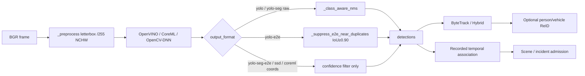

# SurvNG AI Pipeline Audit

**Commit:** `6fc78ac8266a2334b4ec0ce62c8d252866f722a1`

---

## 1. Pipeline overview

Runtime isolation: `inference_runtime` spawn workers with restart delay, crash counters, optional CPU fallback after repeated accelerator failures.

---

## 2. Model loading

| Topic | Finding |
|-------|---------|
| Backends | `openvino` (primary), `coreml` (Darwin), `opencv-dnn` fallback on OpenVINO failure |
| Metadata | IR `model_info` drives labels/NMS/final; Admin override for output format |
| Precision | FP16/FP32 paths tested in `test_detector_model_settings` |
| Reload | Config/path changes via supervisor `reconfigure_roles`; not hot in-process swap |
| Failure | Detector disables with status error on invalid layout; workers return `InferenceUnavailable` during restart window |

**Risk AUD-024:** OpenCV-DNN fallback skips graph NMS op scan (`detector.py` ~319 vs ~396–411).

---

## 3. Preprocessing

`OpenVinoDetector._preprocess` (~1083+): letterbox-style resize with pad metadata, RGB, FP32 `/255`, NCHW — appropriate for typical YOLO exports. OpenVINO may also apply embedded PPP when present.

**ReID** (`person_reidentification.py` `_image_tensor`): stretch resize to fixed shape, float32, **no** `/255` or ImageNet norm — correct only if IR expects 0–255. Output L2-normalized.

**Face detect:** stretch resize, BGR 0–255, NMS assumed inside IR — non-square distortion risk.

---

## 4. Postprocessing / NMS matrix

| Format | SurvNG class-aware NMS | Near-dupe IoU≥0.90 | Assumed model NMS |
|--------|------------------------|--------------------|-------------------|
| `yolo` | 1× | 0 | 0 |
| `yolo-e2e` | 0 | 1× | yes |
| `yolo-seg` | 1× if raw | 0 | 0 |
| `yolo-seg-e2e` | 0 | **0** | yes |
| `ssd` | 0 | 0 | typically in IR |
| CoreML coordinates | 0 | 0 | Core ML |

Status string: `"nms": "SurvNG"` for raw yolo/yolo-seg else `"model final detections"` (`detector.py` ~897–901).

### Can e2e YOLO produce duplicate detections?

**Yes.** Confirmed by unit test: two boxes at IoU **0.80** both retained (`tests/test_detector_model_settings.py:63–98`). Seg-e2e keeps even identical boxes (test lines 119–129).

This is intentional for “final detections” exports but interacts badly with very loose temporal IoU (**0.05**) in recorded motion association (`motion_pipeline/object_detection.py:70–71`) — **AUD-010**.

### Ambiguous shape → e2e (AUD-013)

`detector_model_settings.py:106–108`: six-column, anchors ≤1000 without metadata → `yolo-e2e`, skipping SurvNG NMS. Manual override exists.

---

## 5. Tracking and ReID

| Tracker | Notes |
|---------|-------|
| ByteTrack | Time-based expiry; greedy association; `missed` incremented but unused for expiry |
| Hybrid | Better matching; production default path |
| Sparse identity | Compare/eval oriented; config may normalize to Hybrid |
| Ultralytics adapters | Optional offline/comparison (`requirements-ultralytics-tracking.txt`) |

**ReID thresholds:** person default ~0.70, vehicle ~0.80 (config). Appearance recovery greedy — ID switch risk under occlusion (Supported risk, not a single-line defect).

**Recommendation:** Do **not** add more ReID complexity until duplicate-box and episode-miss defects are fixed; measure ID-switch rate with existing `tracking_evaluation` tools.

---

## 6. Efficiency opportunities

| Issue | Evidence |
|-------|----------|
| Redundant work under mailbox drop | Analysis maxsize=1 — by design stale drop |
| Tensor copies | Expected CPU path; not profiled here |
| Worker restart reload cost | Full model load on spawn |
| Thread oversubscription | See PERFORMANCE_AUDIT |
| Recorded multi-frame detection | Budgeted via `RecordedDecodeBudget` |

Highest correctness-linked optimization: prevent duplicate e2e boxes from merging distinct objects temporally (AUD-010) rather than chasing micro-optimizations.

---

## 7. Face pipeline notes

- Recognition requires landmark alignment; fails closed on bad landmarks — good.
- Default `face_match_threshold` 0.30 is aggressive for cosine on L2 embeddings — false-accept risk as gallery grows (Supported risk).
- Disabled recognition admits no work — tested (`test_face_disabled.py`).

---

## 8. Validation executed

- `tests/test_detector_model_settings.py` — passed in audit batch (e2e duplicate contract, precision/layout, seg-e2e no double NMS).
- Full detector/tracking suites not fully re-run beyond focused set.
