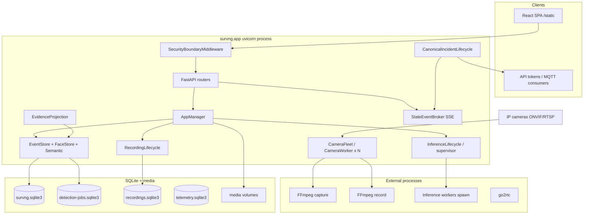
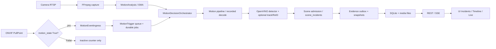
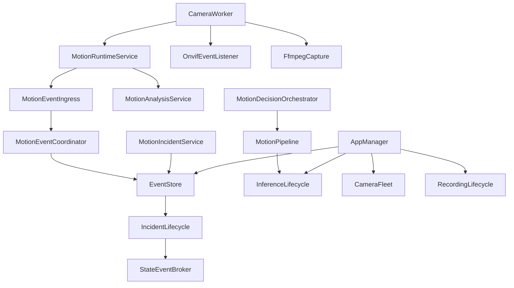

# SurvNG Architecture Review

**Commit:** `6fc78ac8266a2334b4ec0ce62c8d252866f722a1` (`v1.2`)

---

## 1. Current architecture (from code)

SurvNG is a **single-process appliance** (uvicorn/asyncio + many worker threads) that orchestrates:

- External **FFmpeg** capture/record processes
- Spawn-context **inference worker processes** (OpenVINO / CoreML)
- Optional **go2rtc** for WebRTC/MSE
- Multiple **SQLite** databases (main incidents, jobs, recordings, telemetry, exports)

There is no microservice mesh. Modularity is package-level inside `survng/app/`.

### High-level Mermaid

### Actual data flow (adapted)

---

## 2. Module responsibilities

| Module cluster | Responsibility | Key symbols |
|----------------|----------------|-------------|
| `main.py` | App factory, middleware, lifespan | `app`, `lifespan`, `SecurityBoundaryMiddleware` |
| `manager.py` | Process-wide ownership | `AppManager.start_all` / `stop_all` |
| `camera.py` | Per-camera worker | `CameraWorker` |
| `onvif_events.py` | PullPoint lifecycle | `OnvifEventListener` |
| `motion_*` / `ema_v2.py` | Motion admission & decisions | `MotionEpisodeController`, orchestrators |
| `detector.py` / `inference_runtime/` | Model inference | `OpenVinoDetector`, `InferenceSupervisor` |
| `object_track/` | Tracking | ByteTrack / Hybrid / Sparse |
| `recording_process/` | Continuous recording | `Recorder` |
| `event_store/` | Incidents, evidence, jobs schema | `EventStore` mixins |
| `incident_lifecycle.py` | Publish/ack | `CanonicalIncidentLifecycle` |
| `security.py` / `auth_routes.py` | Authn/z | sessions, tokens, scopes |
| `frontend/src` | Operator UI | workspace SPA |

**Storylines:** No module or route named Storyline. Closest constructs are `scene_incidents` / episodes / observations and UI **related incidents** (`relatedIncidents.mjs`).

---

## 3. Dependency relationships

Tight coupling hubs: **`AppManager`**, **`EventStore` (shared write lock)**, **`MotionEpisodeController` (ema_v2)**.

---

## 4. Concurrency model

| Context | Mechanism |
|---------|-----------|
| HTTP / SSE / WS | asyncio event loop + threadpool for sync routes |
| Per camera | Capture thread(s), ONVIF thread, motion analysis, decision, refinement threads |
| Motion queues | Bounded trigger queue (32), analysis mailbox maxsize=1 drop-oldest |
| Inference | Multiprocessing spawn workers; request locks; restart delay |
| Recording | One FFmpeg process per `(camera_id, source)` |
| Main DB | Process-wide RLock for writes; WAL readers concurrent |
| Reload | Generation leases + reload RLock |

**Isolation:** A failed camera generally does not stop others, but **global `CAPTURE_OPEN: 2`** and **shared `survng.sqlite3` writer** create cross-camera latency coupling.

---

## 5. Architectural weaknesses

1. **Single main-DB write domain** for events + faces + semantic + appearance → scale cliff (~50+ cameras).
2. **Episode controller silent swallow** of camera-only observations after COMPLETED (correctness coupled to EMA availability).
3. **ONVIF semantics incomplete** (no motion-end plumbing) — reliability depends on gap timers.
4. **Insecure-by-default network posture** contradicts “appliance with sensitive evidence” threat model.
5. **God-ish surfaces:** `camera.py`, `detector.py`, `event_store/store.py`, `IncidentsPage.jsx`, `ConfigPage` chunk size — maintainability drag, not immediate correctness bugs.
6. **Optional Ultralytics path** is comparison/offline-oriented; production tracker defaults stay Hybrid — good, but dual ecosystems increase cognitive load.

---

## 6. Recommended improvements (architecture-level)

Prefer **incremental** changes:

| Improvement | Why | Effort |
|-------------|-----|--------|
| Auth-required for non-loopback bind | Closes default exposure without rewriting security | Small |
| Plumb ONVIF inactive → episode freeze/end | Completes motion state machine | Medium |
| Guard scene state transitions in SQL | Prevents illegal resurrection | Small |
| Index `events.recording_path` + incremental protected-set | Retention scalability | Medium |
| Split face/semantic write paths or batch under storms | Writer contention | Large |
| Pin OpenVINO/OMP threads vs worker topology | Avoid oversubscription | Small–Medium |

**Do not** introduce microservices unless a measured single-host cliff remains after Wave 3–4.

---

## 7. Documentation vs reality

| Documented / assumed | Reality in code |
|----------------------|-----------------|
| “Storylines” product feature | Absent; use scene + related incidents |
| GStreamer pipeline | Not used; FFmpeg/OpenCV |
| Auth as optional convenience | Optional but catastrophic if left off on exposed hosts |
| e2e models “final” detections | SurvNG still applies weak near-dupe for `yolo-e2e` only; `yolo-seg-e2e` none |
| Closing DB connections | `ClosingDatabaseConnection.__exit__` now closes (hardening audit P2 appears addressed for factories using it) |

Prior audits (`docs/dead-code-audit-2026-10-04.md`, `docs/production-hardening-audit.md`) are largely consistent with current structure; this audit extends them with motion state-machine and scale findings still open at HEAD.
