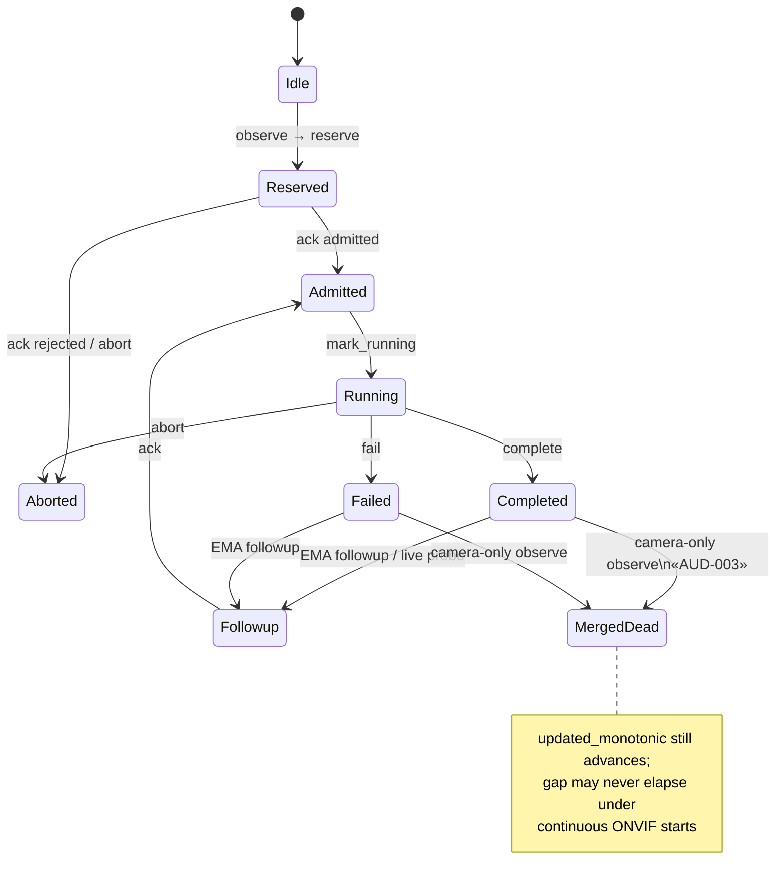
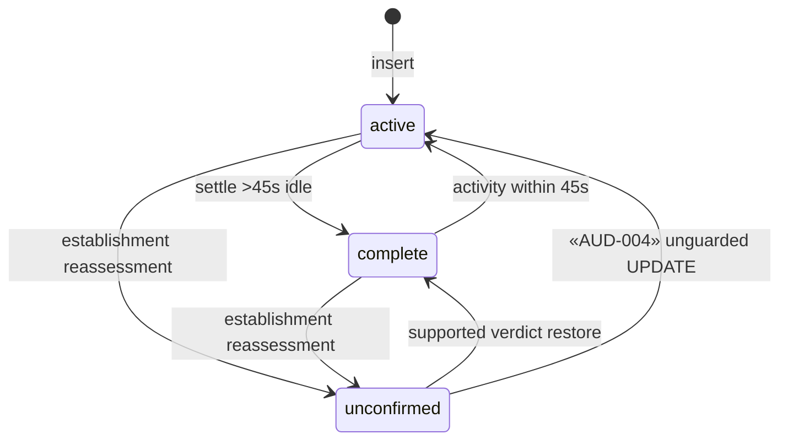

# SurvNG Reliability Audit

**Commit:** `6fc78ac8266a2334b4ec0ce62c8d252866f722a1`

---

## 1. 24/7 operational posture

SurvNG includes many patterns required for unattended operation: generation fencing, durable jobs/outboxes, bounded live queues, inference worker respawn, recorder watchdog, retention claims. Remaining gaps are **silent semantic failures** (missed motion, illegal incident state) and **scale-induced latency**, not obvious crash loops.

**Verdict:** Architecturally oriented toward 24/7, but **not proven** for multi-day soak at HEAD; critical motion/state defects can lose security events without process death.

---

## 2. Motion / detection / incident state machines

### Motion episode (simplified from `ema_v2.py`)

### Scene incident

---

## 3. Confirmed reliability defects

| ID | Summary | Silent? |
|----|---------|---------|
| AUD-003 | Post-complete camera-only merge swallows new work | Yes — no incident |
| AUD-004 | `unconfirmed` → `active` rewrite | Yes — wrong alert |
| AUD-007 | Motion-end ignored | Yes — long episodes |
| AUD-008 | Resubscribe event loss | Yes — gap |

---

## 4. Concurrency and resource risks

| Risk | Detail |
|------|--------|
| Cross-camera capture open | Global limit 2 (`media_sessions.py`) — storm control + delay |
| Unbounded `retry_batches` | Only when durable store absent (`motion_events.py`) |
| Inference restart window | Requests fail until respawn (~1s+) |
| Recorder watchdog soft stop | 2s join then continue — brief orphan risk |
| Main DB lock | Latency under load, not corruption if WAL healthy |
| FD/connection ownership | `ClosingDatabaseConnection` closes on exit (improved vs older audit note) |

---

## 5. Recovery matrix

| Failure | Automatic recovery? | Notes |
|---------|---------------------|-------|
| Camera disconnect | Yes | Capture reconnect with backoff; open limiter |
| Network outage | Partial | ONVIF resubscribe; event loss possible (AUD-008) |
| Database lock/busy | Partial | busy_timeout on main/jobs/telemetry; recordings index weaker (AUD-016) |
| Disk full | Partial | Retention/pressure paths; exports hardened previously; not fully injected here |
| Corrupt evidence file | Partial | Reconciler clears missing refs; orphans not deleted (AUD-022) |
| Model load failure | Yes | Detector disabled with status; OpenCV fallback risk (AUD-024) |
| Inference worker crash | Yes | Respawn + CPU fallback after repeated failures |
| Process restart | Yes | Durable jobs/outboxes; generation reset |
| Host reboot | Depends | systemd/docker restart; bootstrap auth still required |

---

## 6. Cascading failure FMEA (Phase 13)

| Cascade | Mechanism | Effect | Isolation gap |
|---------|-----------|--------|---------------|
| Slow inference → stale evidence | Decision/refinement backlog; durable rows grow | Late covers; operator sees old frames | Admission sheds optional work; durable growth unbounded by time |
| Camera reconnect → duplicate motion | New PullPoint + gap timers; start-default topics | Extra triggers; usually deduped by episode/jobs | AUD-017 false starts |
| DB contention → delayed incidents | Shared writer lock | UI lag; late MQTT/SSE | Jobs DB separate (good) |
| Tracking state > camera session | Lifecycle replace sessions | Possible stale tracks if generation miss | Generation fencing intended |
| Retention deletes vs storylines | N/A named storylines; related incidents use event IDs | Protected paths prevent recording delete while referenced | Soft FKs faces (AUD-014) |
| Frontend pagination loses selection | Incidents page clears retention off-page | Operator confusion, not backend corruption | UX only |
| Retry storms | ONVIF exponential backoff; capture open limiter | Bounded | Good |

**Single points of failure:** uvicorn process, main `survng.sqlite3`, host disk, inference supervisor (all cameras share detector pool).

**Graceful degradation opportunities:** Detect AUD-003 merges as metric; alert on ONVIF resubscribe rate; read-only UI mode when disk critical.

---

## 7. Hidden defect most dangerous for ops

**AUD-003 + AUD-007 together:** Continuous ONVIF motion starts after a completed detection can prevent episode rollover while never reserving new work when EMA is quiet. The process looks “healthy,” cameras show motion, and **a second intrusion is never analyzed**. No crash, no red banner.

---

## 8. Soak recommendation

Use `scripts/production-soak.py` per `docs/production-hardening-audit.md` (12–24h) after Wave 1–2 fixes. This audit did not run soak.
