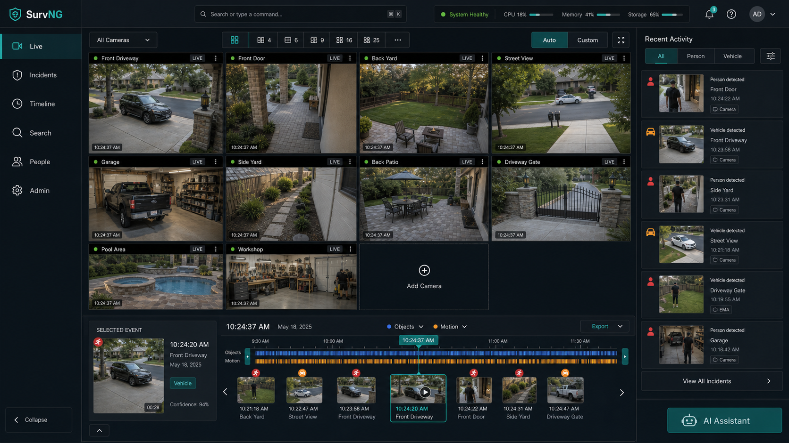

# Welcome to SurvNG

SurvNG watches your cameras, keeps continuous video history, and helps you find the moments that matter — in a browser on your computer or phone.



## Table of contents

### Start here

1. [Concepts](concepts.md) — terms used throughout SurvNG
2. [Getting started](getting-started.md) — open the app, add a camera, confirm recording

### Workspaces

3. [Live view](live.md) — what is happening right now
4. [Property](property.md) — bird's-eye coverage of the home
5. [Incidents](incidents.md) — activity SurvNG kept for review
6. [Timeline & exports](timeline.md) — scrub recorded video and save clips
7. [Search](search.md) — find activity with filters, a short description, or Find similar
8. [People](people.md) — faces SurvNG has seen and people you name
9. [Admin](admin.md) — configure cameras, detection, storage, and health

### Configuration topics

10. [Cameras](cameras.md) — connect streams and camera motion notices
11. [Motion & detection](motion-detection.md) — when SurvNG looks closer at a frame
12. [Zones](zones.md) — watch the parts of the picture that matter
13. [Recordings & storage](storage.md) — how long video is kept and where it lives
14. [AI assistant](assistant.md) — ask questions about health and incidents
15. [Integrations](integrations.md) — Home Assistant, MQTT, and API tokens
16. [Access](access.md) — sign-in roles and HTTPS certificates
17. [Reverse proxy](reverse-proxy.md) — nginx, trusted proxies, and internet exposure
18. [HTTP API](api.md) — endpoints, authentication, and examples

## Related technical notes

- [Motion triggers and validation](../adaptive-motion.md)
- [Multi-disk media storage](../storage.md)
- [Storage retention](../storage-retention.md)
- [Smart Search model packages](../semantic-search.md)
- [Docker installation](../docker.md)
- [Configuration application boundaries](../configuration-application.md)
- [Training samples API](../training-api.md)
- [Recording frame API](../recording-frame-api.md)
- [Incident evidence data path](../incident-evidence-data-path.md)

## Open this guide in SurvNG

When SurvNG is running, open **Help** in the left navigation, or go to:

```text
http://YOUR-SERVER:8088/survng/help
```

Replace the host and path if you use a different address or `base_path`.
