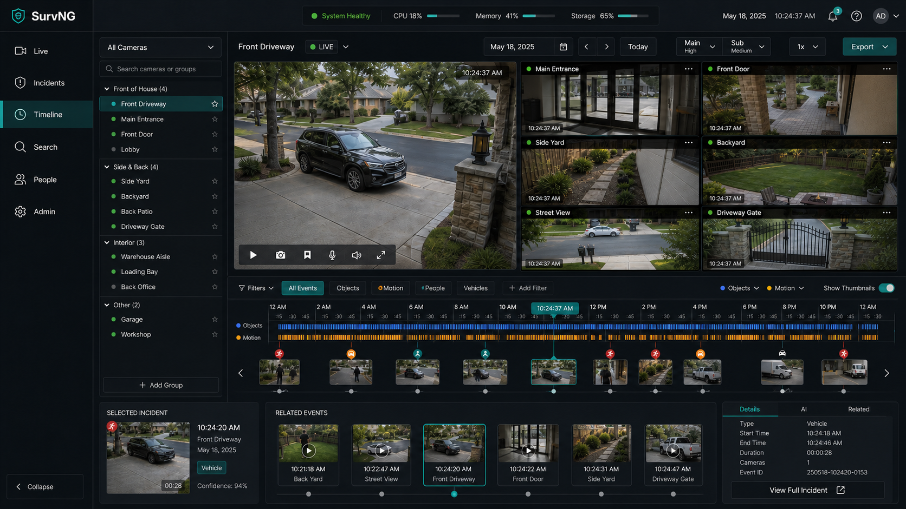

# Timeline & exports

**Timeline** answers: what happened around this time on this camera?

## Scrub recorded video

1. Open **Timeline**.
2. Pick a camera (or **All cameras** for a grid on larger screens).
3. Choose the day with the date under the video (on a phone, the date at the top).
4. Scroll or drag the rail beside the video until the time you care about is
   under the playhead line. Newest time is at the top. The arrow, Page and
   Home/End keys work too, and the narrow day strip at the rail's edge jumps
   across the whole day.
5. Switch between **Main** and **Sub** recordings when both exist.

While you scrub, the player shows the frame under the line. When you let go,
playback resumes from that moment. The **15m / 1h / 6h / 24h** buttons zoom the
rail.

## Views

- **Timeline**: the rail of events and time described above.
- **Catch up**: the day's events as a short story, with quiet stretches
  collapsed. Pick an event to play it, or show it on the rail.
- **Cameras**: one lane per camera, so you can follow activity across cameras.

## Exact time links

You can share or bookmark a Timeline moment. SurvNG carries the requested time in the link and reports the actual decoded time when the player knows it.

## Filters

**All**, **People**, **Vehicles** and **Motion** above the rail choose which events
it shows. Event cards and markers help you jump between interesting points
instead of watching hours of empty driveway, and **Previous** / **Next** under the
video step from one event to the next.

## Find similar from a frame

When Smart Search is enabled, pause near the subject you want to investigate
and choose **Find similar**. SurvNG freezes the current frame so you can crop the
person, vehicle, or object precisely, then searches indexed incident evidence.
Results remain in an evidence rail while you inspect matches or move to nearby
evidence. Use the previous/next controls to follow the trail, or **Exit** to
return to ordinary Timeline playback.

This search uses the selected crop as visual evidence; it does not create or
modify incidents. See [Search](search.md) for object-based and text searches.

## Exports

**Exports** is the place to save a clip or timelapse for download.

Typical flow:

1. Select a time range on Timeline.
2. Start an export.
3. Watch progress in the background-task status (you can leave the page while it runs).
4. Open **Exports** to download, protect, or delete finished jobs.

Protected exports are kept even when ordinary retention cleanup runs.

### Example

You want a 45-second clip of a package drop:

1. Timeline → camera `Porch` → today → scrub to 14:02.
2. Select from 14:02:00 to 14:02:45.
3. Export as a normal recording clip.
4. Download from **Exports** when the job finishes.

## Related

- [Recordings & storage](storage.md)
- [Incidents](incidents.md)
- [Recording frame API](../recording-frame-api.md)
